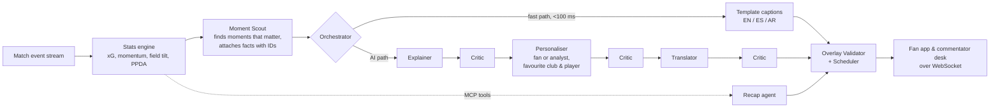

# Premier Analytics

**Live match intelligence that explains *why*, not just *what*, for every fan in their own language.**

A team of AI agents watches a football match event by event and turns raw data into short on-screen
explanations: why a goal matters, why momentum just swung, why a spell of pressure is dangerous. Fans get
plain words on their phone; commentators get the numbers on a laptop desk. Every statement is checked
against the data before it reaches a screen, and the match never waits for the AI: an instant template
caption shows first and the AI version replaces it seconds later.

Built for the Microsoft × Premier League *Inside the Game* hackathon, Best Multi-Agent System category.

**Try it:** https://premier-analytics.salmondune-d779c5b4.switzerlandnorth.azurecontainerapps.io
Open it on a laptop for the commentator desk and scan the QR code to follow the same match on your phone.
For broadcast, `/overlay?match=…` is a transparent page (scorebug and a lower third that pops up with each new graphic) to drop over video as a browser source, e.g. in OBS.

| Fan app (phone) | Commentator desk (laptop) |
|---|---|
| Live score, a mini pitch showing where the ball is (tinted by who has it), animated goals, red cards and big chances, AI explanations in English, Spanish or Arabic, an attack-momentum chart that says *why* it leans one way, and your favourite club pinned. | A neutral broadcast console: both line-ups as a spotting board (bookings, subs, goals, each player's live numbers), a timeline of every goal, card and substitution, full-match vs last-10-minute stats, season form and table, a Pattern Analyst panel that draws how each team is playing on the pitch, AI talking points with their evidence that you tick off as you use them, sourced real-world context beside big moments, and an ask box that searches the web. |

## How it works



- **Stats engine**: running totals and rolling windows from each event: expected goals (xG), attack momentum, territory, pressing intensity.
- **Moment Scout**: decides what is worth showing (goals, big chances, pressure spells, momentum swings, red cards, half-time, full-time) and how important each is. It hands the AI a numbered list of facts; the AI may only use those.
- **Orchestrator**: runs two paths at once. The fast path puts a template caption on screen immediately. The AI path upgrades it in place when it's ready, and is simply skipped if the models are slow or down. Work is shared across viewers: one explanation per moment, one personalisation per audience type, one translation per language.
- **Agents** (Microsoft Agent Framework on Microsoft Foundry models):
  - *Explainer*: writes why the moment matters, citing fact IDs.
  - *Personaliser*: rewrites it for a fan or an analyst, and for the viewer's club or player.
  - *Translator*: Spanish and Arabic. Player and club names are masked so they are never translated or transliterated.
  - *Critic*: a deterministic checker run after every AI step. It rejects any number, player or club not in the facts, wrong goal context (calling an equaliser a "lead"), jargon in fan text, and anything too long for the screen. A rejected rewrite falls back to the last good version.
  - *Recap agent*: writes half-time and full-time summaries by querying match data through an **MCP server** (`get_score`, `get_team_stats`, `get_player_stats`, `get_top_players`, `get_key_moments`).
  - *Researcher*: uses **Foundry web search** to find real Premier League benchmarks and tactics explainers with sources. Offline it builds a reviewed context library (every number must appear on a cited page and agree with a second source); live it answers the commentator's questions in the ask box.
  - *Storyline agent* and *Storyline Watcher*: before kick-off the desk gets a printable brief from the simulated season (earlier meetings, players to watch, known styles) and 3-5 suggested storylines, each worded from a computed fact and checked by the Critic. The commentator follows up to four, or types their own (it must name a player or club in the match). During the match the Watcher links moments to storylines and posts short updates; the Producer boosts moments that feed a storyline, and the cue says which.
  - *Ask Router* and *Match Analyst*: the desk's ask box. The router decides whether a question is about this match or football beyond it (which goes to the Researcher). The Match Analyst answers match questions by calling the same read-only tools the MCP server exposes (score, team and player stats from any minute, top players, key moments, cards and substitutions with reasons); every number and player in its answer must come from what the tools returned, with one retry, otherwise the commentator gets the tool facts without a narrative. Answers show "as of" the minute and the tool calls behind them; questions the data can't answer (offsides, distance run) are said to be outside the feed.
  - *Pattern Analyst*: spots how each team is playing: which flank they attack, where they win the ball, who makes them tick, counter-attacks, a switch since half-time. A pattern is only reported if an exact significance test says it isn't chance (tuned on 380 simulated matches: strong styles found in most matches, false alarms under 5 %), and each club's known style from the season is shown next to today's numbers. The agent turns them into one-line notes on the desk (with the pattern drawn on the pitch), "new pattern" alerts among the talking points, and a plain "How they're playing" card for fans.
  - *Producer*: the gallery's producer. Every other agent's output (explanations, pattern alerts, substitution cards) becomes a candidate talking point; rules rank them (importance × freshness, real-world context and storylines boosted, never repeating what the commentator has used) and put the best one **on air** at natural breaks, with how long the break usually lasts (measured from the simulation). An AI producer may add one Critic-checked line of angle, or stay silent. "Used" is shared by every desk on the match.
  - *Context agent*: beside big moments on the desk, adds one line of real-world context from that library ("Northgate's PPDA of 16.7 means they are pressing less than…"), with the source links. Its numbers are checked like everything else.
- **Substitution cards** (no AI, so instant): the desk gets a pop-up for each change with what the player going off did today, both players' season numbers, subs used, the score and whether it was like-for-like or a more attacking or defensive change; fans get the same in plain words, marked if it's their followed player; the broadcast graphic adds one key stat.
- **Overlay Validator and Scheduler**: final checks (evidence present, length, freshness) and placement, so overlays never pile up on screen.

### Microsoft and Azure services

| Service | Used for |
|---|---|
| **Microsoft Foundry** | `gpt-4.1-mini` for live explanations, `gpt-5-mini` for recaps and as automatic fallback |
| **Microsoft Agent Framework** | Agent definitions, structured outputs, model clients, hosted web search tool |
| **Foundry web search** | The Researcher's sourced answers about real football (benchmarks, tactics) |
| **Azure Container Apps** | Hosting (one container: FastAPI + React build) |
| **Managed identity (Microsoft Entra ID)** | Keyless access to Foundry and the container registry; no API keys in the app |
| **Azure Container Registry** | Images |
| **Application Insights** (OpenTelemetry) | One trace per moment with a span per agent step, following the GenAI semantic conventions |
| **Azure AI Evaluation SDK / Foundry evaluations** | Groundedness, relevance, coherence, fluency, plus a custom "explains why" judge |

## Data

All matches are **synthetic**: a simulator generates realistic event streams for 20 fictional clubs with
fictional players, calibrated to published Premier League 2024/25 season averages (goals, shots, xG, cards,
corners, penalties, possession and more; see [docs/REALISM.md](docs/REALISM.md)). Every match is reproducible from its seed. No
real player, club or Premier League data, logos or fonts are used.

## Results

Evaluated on 3 matches × 4 audiences (142 AI captions, final check 15 Oct); full write-up in [docs/EVALS.md](docs/EVALS.md).

| | |
|---|---|
| Published text that passes the Critic re-check | 100 % |
| Groundedness (Azure AI Evaluation, 1–5) | 4.85 |
| Output in the requested language | 100 % |
| Analyst version carries more numbers than the fan version | 94 % |
| Explains *why* (custom judge, 1–5) | 4.22 (from 3.09 at the first evaluation): spells, missed chances and goals come with computed meaning |

## Run it locally

Needs Python 3.12+ and Node 22. **No Azure account is needed**: `PA_AI=fake` uses scripted offline agents.

```bash
python3 -m venv .venv && source .venv/bin/activate
```

```bash
pip install -e ".[dev,llm]"
```

```bash
npm --prefix web ci && npm --prefix web run build
```

```bash
PA_AI=fake uvicorn premier_analytics.server:app --port 8000
```

Then open http://localhost:8000. Other modes: `PA_AI=off` (templates only) and `PA_AI=down` (every model
call fails, showing the fast path carrying on alone).

### With Microsoft Foundry

Create a `.env` (it is gitignored) with:

```
AZURE_OPENAI_ENDPOINT=https://<resource>.services.ai.azure.com/api/projects/<project>
LIVE_MODEL_DEPLOYMENT=gpt-4.1-mini
RECAP_MODEL_DEPLOYMENT=gpt-5-mini
```

Sign in with `az login` (an identity with the *Azure AI User* or *OpenAI User* role on the resource), then run
`uvicorn premier_analytics.server:app --port 8000`. Authentication is keyless via `DefaultAzureCredential`.
Optional: `APPLICATIONINSIGHTS_CONNECTION_STRING` for tracing.

Command-line demos: `python scripts/live_match.py har ngc 42` streams a match with live AI captions in the
terminal; `python scripts/live_recap.py` produces recaps.

## Tests

Requirements come first: every requirement in [REQUIREMENTS.md](REQUIREMENTS.md) is traced to tests in
[TEST_PLAN.md](TEST_PLAN.md).

```bash
pytest -m "not e2e"
```

```bash
npm --prefix web test
```

```bash
pytest tests/e2e
```

- **Python (463 tests)**: data realism against the season targets, stats engine, Moment Scout, Critic, agents with fake models (including timeouts, outages and models that make things up), orchestrator, MCP server, recaps, WebSocket app, commentator data feed and simulated season, real-world context checks (sources, second source, invented numbers), tracing, evaluation metrics.
- **Frontend (94 tests, Vitest)**: state, pitch zones, scoreboard, momentum explanations, line-up markers and formation, digits, translations, saved preferences.
- **Browser (45 tests, Playwright)**: the real app with scripted agents: phone and desk flows, the desk staying neutral and fitting 1280×720 to 1920×1080, languages and right-to-left Arabic, favourite club, AI off and model outages. Needs the web build and `python -m playwright install chromium`.
- **Evaluations** against live models: `python scripts/run_evals.py` (≈ 15 min, under $1).

CI (GitHub Actions) runs all three suites, builds the Docker image and checks the container starts, and scans for secrets.

## Deploy

`scripts/deploy.sh` builds the image in Azure Container Registry and rolls out a new Container Apps revision,
then waits until `/api/health` reports the new version. Setup and the reasons behind each choice are in
[docs/DEPLOYMENT.md](docs/DEPLOYMENT.md).

## Repository

```
src/premier_analytics/   engine, scout, agents, orchestrator, MCP server, recaps, app, telemetry, evals
web/                     React + TypeScript frontend (fan app, commentator desk)
tests/                   pytest, Playwright (tests/e2e)
scripts/                 demos, deploy, evaluations, calibration
docs/                    realism targets, deployment, evaluation report
schemas/                 match event JSON schema
```

## Responsible AI

- **Grounded by construction**: agents see only numbered facts from the data, must cite them, and a deterministic Critic blocks anything unsupported before it is shown.
- **Never blocked by AI**: if models are slow, wrong or down, viewers still get accurate template captions.
- **Names are never translated**: they are masked during translation and restored afterwards.
- **No personal data**: favourite club is stored only in the viewer's browser; prompts and completions are not recorded in telemetry.
- **Known limits**: the Critic checks numbers, names and goal context but not comparative words such as "double"; see [docs/EVALS.md](docs/EVALS.md).

*Not affiliated with or endorsed by the Premier League. All clubs, players and matches are fictional.*
