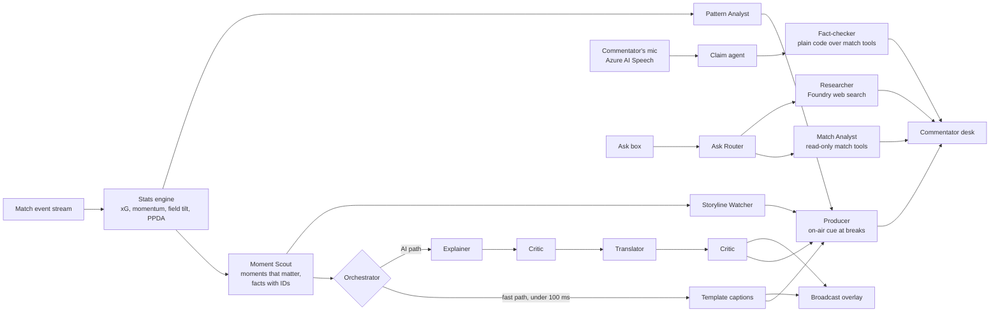

# Premier Analytics

**An AI production team for live football commentary. It gives every caster the club knowledge of a seasoned
specialist: what to say next, why it matters, and a live check on what they just said.**

**Live:** https://premier-analytics.salmondune-d779c5b4.switzerlandnorth.azurecontainerapps.io

## The problem

Good commentary depends on deep knowledge of the clubs: their form, their style, who makes them tick, what
happened last time they met, and the numbers behind every claim. That knowledge takes years to build and hours
of preparation per match, so:

- **Lesser-known leagues get weaker coverage.** Broadcasters can only staff them with casters who already know
  those clubs, and there are few of them.
- **Less experienced casters struggle.** They miss the story behind a moment, or say a wrong stat on air, and
  lose the audience's trust.
- **Top broadcasts have whole teams** of researchers, statisticians and producers in the commentator's ear.
  Most matches have nobody.

## The solution

Premier Analytics supplements the caster's knowledge, live. A team of AI agents watches the match event by event
and works like a broadcast gallery around the person on the mic, so:

- a **good caster can cover an unfamiliar league** with a specialist's preparation and context, and
- a **less experienced caster gets better**: prompted with the right talking point at the right time, and
  corrected the moment they get a number wrong.

Every number on screen is checked against the match data before it is shown, and the match never waits for
the AI: an instant caption appears first and the AI version replaces it moments later.

Built for the Microsoft × Premier League *Inside the Game* hackathon, Best Multi-Agent System category.

## The commentator desk

Start a match on the website and open the **commentator desk** (on a laptop, or scan the QR code for a tablet).
Tick *Hold kick-off for the desk* to prepare before the match starts.

**Before kick-off: prep**
- A printable **brief** built from the season: table and form, earlier meetings, players to watch, and each
  club's known style.
- **Suggested storylines** to follow, or type your own (any storyline about a player or club in the match).

**During the match**
- **Producer cue**: the best thing to say next, put **on air** at each natural break (free kick, substitution,
  goal…) with how long that break usually lasts.
- **Live fact-check**: press *Listen* and talk. Every line is checked against the match: ✓ when you are right,
  ⚑ with the correct number when you are not ("Northgate: 47% possession, not 60"). You can also type a line.
- **Talking points** with their evidence, real-world context with sources, and *Say it simply*: a plain line
  ready for casual viewers ("From 4 m out, chances like this go in about 6 times in 10").
- **Ask** about the match ("How has Kowalczyk done since he came on?"), answered from the live data with the
  evidence shown, or about real football (sourced web answers).
- **Storyline updates** as the match feeds each storyline you follow.
- **Pattern Analyst**: how each team is playing (favoured flank, pressing, long shots, who makes them tick),
  shown only when a significance test says it is not chance, and drawn on a pitch.
- **Line-ups as a spotting board** (click a player for their numbers, or *focus* on them to highlight everything
  they do), a ticking clock with stoppage time and possession, stats by half with an attack-momentum chart, a
  timeline with card reasons, and a card for every substitution.
- **Production**: a transparent **broadcast overlay** (`/overlay?match=…`, a scorebug and a lower third in plain
  wording for viewers at home) to drop over video, e.g. in OBS; recaps at half-time and full-time; and the live
  activity of every agent.

The desk works in **13 languages**: English, Spanish, Arabic (right to left), French, German, Italian, Portuguese,
Dutch, Turkish, Chinese, Japanese, Korean and Hindi. Every caption, card reason, fact-check verdict and explainer has
written wording in each, so the desk works in any of them with the AI off, and *Listen* uses that language's speech
model. A short *How this desk works* guide opens on the first visit.

## How it works



**Code computes, the model explains.** Every number comes from the deterministic stats engine; the models only
choose and phrase. A deterministic **Critic** runs after every AI step and rejects any number, player or club not
in the facts, wrong goal context (calling an equaliser a "lead"), comparisons the numbers do not support, and
anything too long for the screen. A rejected line falls back to the last good version, so something accurate is
always on screen.

| Agent | AI or code | What it does |
|---|---|---|
| **Producer** | rules + AI note | Ranks everything the other agents produce (importance × freshness, boosts for real-world context and storylines, never repeating what was used) and puts the best point on air at natural breaks. An AI producer may add one checked line of angle, or stay silent |
| **Explainer** | AI | Why a moment matters, citing fact IDs |
| **Personaliser / Translator** | AI | Commentator or broadcast wording; the other 12 languages with player and club names masked so they are never translated |
| **Critic** | code | Checks every AI line against the facts before it is shown |
| **Claim agent** + **Fact-checker** | AI + code | The Claim agent only turns what the commentator said into structured claims (who, which stat, what number, from when); the Fact-checker compares them with the match in plain code |
| **Ask Router** + **Match Analyst** | AI | The router separates questions about this match from real-world ones; the analyst answers from read-only match tools, every number checked, with the tool calls shown |
| **Researcher** + **Context agent** | AI | Foundry web search for real benchmarks and tactics, with sources (numbers must appear on a cited page and agree with a second source); one line of context beside big moments |
| **Storyline agent** + **Storyline Watcher** | AI + code | Suggests storylines from computed season facts; links moments to the storylines being followed |
| **Pattern Analyst** | code + AI | Detects playing patterns with an exact significance test (tuned on 380 simulated matches: strong styles found in most matches, false alarms under 5 %); the agent words them |
| **Recap agent** | AI | Half-time and full-time recaps; the match tools are also served as an **MCP server** (`scripts/live_recap.py` runs the recap through it) |

### Microsoft and Azure services

| Service | Used for |
|---|---|
| **Microsoft Foundry** | `gpt-4.1-mini` for live work, `gpt-5-mini` for recaps and as automatic fallback |
| **Microsoft Agent Framework** | Agents, structured outputs, tool calling (the Match Analyst), hosted web search |
| **Foundry web search** | The Researcher's sourced answers about real football |
| **Azure AI Speech** | The desk's *Listen* button in all 13 languages (in the browser, with a phrase list of the match's names; without it fictional names were misheard) |
| **Azure Container Apps** | Hosting (one container: FastAPI + React build) |
| **Managed identity (Microsoft Entra ID)** | Keyless access to Foundry, Speech and the container registry; no keys in the app or the browser |
| **Application Insights** (OpenTelemetry) | A trace per moment with a span per agent step (GenAI semantic conventions) |
| **Azure AI Evaluation SDK / Foundry evaluations** | Groundedness, relevance, coherence, fluency, plus a custom "explains why" judge |

## Data

All matches are **synthetic**: a simulator generates realistic event streams for **8 fictional clubs** with
fictional players, calibrated to published Premier League season averages (goals, shots, xG, cards and their
reasons, corners, penalties, possession and more; see [docs/REALISM.md](docs/REALISM.md)). Seasons are simulated
too, which gives the brief its table, form and known styles. Every match is reproducible from its seed. No real
player, club or Premier League data, logos or fonts are used.

## Results

Evaluated on 3 matches and 4 audiences (142 AI captions, final check 15 Oct); write-up in [docs/EVALS.md](docs/EVALS.md).

| | |
|---|---|
| AI text that passes the Critic re-check | 100 % |
| Groundedness (Azure AI Evaluation, 1–5) | 4.85 |
| Output in the requested language | 100 % |
| Explains *why* (custom judge, 1–5) | 4.22 (from 3.09 at the first evaluation) |
| Fact-check, live model, spoken-style lines | about 0.7 s per line |

## Run it locally

Needs Python 3.12+ and Node 22. **No Azure account is needed**: `PA_AI=fake` uses scripted offline agents.

```bash
python3 -m venv .venv && source .venv/bin/activate
```

```bash
pip install -e ".[dev,llm]"
```

```bash
npm --prefix web ci && npm --prefix web run build
```

```bash
PA_AI=fake uvicorn premier_analytics.server:app --app-dir src --port 8000
```

Then open http://localhost:8000. Other modes: `PA_AI=off` (no AI at all) and `PA_AI=down` (every model call
fails, showing the fast path carrying on alone).

### With Microsoft Foundry

Create a `.env` (it is gitignored; see `.env.example`) with:

```
AZURE_OPENAI_ENDPOINT=https://<resource>.services.ai.azure.com/api/projects/<project>
LIVE_MODEL_DEPLOYMENT=gpt-4.1-mini
RECAP_MODEL_DEPLOYMENT=gpt-5-mini
AZURE_SPEECH_RESOURCE_ID=<the AIServices resource ID, for the Listen button>
```

Sign in with `az login` (an identity with the *Foundry User* role on the resource) and start the server as
above without `PA_AI`. Authentication is keyless via `DefaultAzureCredential`. Optional:
`APPLICATIONINSIGHTS_CONNECTION_STRING` for tracing.

## Tests

Requirements come first: every requirement in [REQUIREMENTS.md](REQUIREMENTS.md) is traced to tests in
[TEST_PLAN.md](TEST_PLAN.md), and every design decision is logged there with the reason.

```bash
pytest -m "not e2e"
```

```bash
npm --prefix web test
```

```bash
pytest tests/e2e
```

- **Python (661 tests)**: data realism against season targets, stats engine, Moment Scout, Critic, every agent
  with scripted models (including timeouts, outages and models that make things up), Producer, fact-check,
  Match Analyst, storylines, orchestrator, MCP tools, recaps, WebSocket app, tracing, evaluation metrics.
- **Frontend (115 tests, Vitest)**: state, the cue's timing, storylines, fact-check log, Listen's phrase list,
  plain-words explanations, card reasons, line-ups, every language's catalogue.
- **Browser (41 tests, Playwright)**: the real app with scripted agents: prep and kick-off, the Producer cue,
  fact-check, Ask, focus player, Say it simply, the overlay, fitting 1280×720 to 1920×1080 (in French, German and Japanese too), contrast,
  the language dropdown and right-to-left Arabic, AI off and model outages. Needs the web build and `python -m playwright install chromium`.
- **Evaluations** against live models: `python scripts/run_evals.py` (about 15 min, under $1).

CI (GitHub Actions) runs the suites, builds the Docker image and checks it starts, and scans for secrets.

## Deploy

`scripts/deploy.sh` builds and pushes the image, rolls out a new Container Apps revision (with the speech
settings), then waits until `/api/health` reports the new version. Details in [docs/DEPLOYMENT.md](docs/DEPLOYMENT.md).

## Repository

```
src/premier_analytics/   stats engine, scout, agents, Producer, fact-check, Match Analyst, storylines,
                         patterns, orchestrator, MCP tools, recaps, app, telemetry, evals
web/                     React + TypeScript: commentator desk, broadcast overlay, landing page
tests/                   pytest, Playwright (tests/e2e)
scripts/                 deploy, evaluations, calibration, command-line demos
docs/                    realism targets, deployment, evaluation report
schemas/                 match event JSON schema
```

## Responsible AI

- **Grounded by construction**: agents see only numbered facts or tool results, and a deterministic Critic
  blocks anything unsupported before it is shown. The fact-checker itself is plain code.
- **Never blocked by AI**: if the models are slow, wrong or down, the desk still gets accurate template captions.
- **Names are never translated**: they are masked during translation and restored afterwards.
- **The microphone stays private**: audio goes straight from the browser to Azure Speech; transcripts are
  checked and discarded, never stored or logged. Prompts and completions are not recorded in telemetry.
- **Known limits**: the Critic checks numbers, names, goal context and comparison words, but not every
  qualitative claim; see [docs/EVALS.md](docs/EVALS.md).

*Not affiliated with or endorsed by the Premier League. All clubs, players and matches are fictional.*
